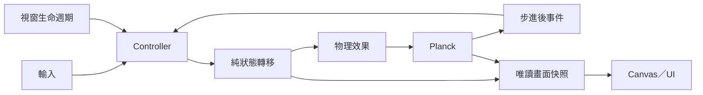
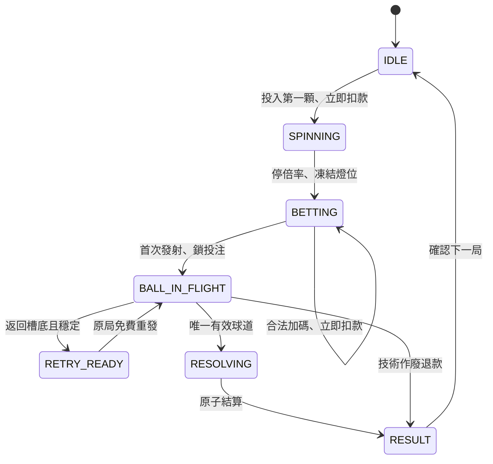

# 技術設計與候選決策

本文保留整體規劃與候選決策。Phase 0 已開始，只有明確附驗證證據的部分可稱已測；確認需求以 `REQUIREMENTS.md` 為準，實際成果以 `STATUS.md` 為準。

## 1. 選型與 Windows 風險

首選 TypeScript + Tauri 2 + Vite + Canvas 2D + Planck，Windows 使用 WebView2。Rust 僅負責必要的視窗、系統匣等原生工作；不把物理 tick 或遊戲規則透過 IPC 分散到 Rust。

只有一顆動態球、數十至數百固定障礙，預期負載合理，但沒有實測前不能宣稱已達 60 FPS。不需 React／Vue、WebGL、ECS、Worker、DI 容器、事件框架或後端。

### 透明必須貫穿四層

Windows 原生視窗 → WebView2 底色 → HTML／body／根容器 → Canvas Alpha。只設 CSS 透明不能證明桌面穿透。

候選視窗設定（片段，非完整設定檔）：

```json
{
  "width": 260,
  "height": 420,
  "transparent": true,
  "decorations": false,
  "shadow": false,
  "resizable": false,
  "alwaysOnTop": false,
  "noRedirectionBitmap": false
}
```

- HTML、body、容器清底；移除 margin、捲軸，不畫整片背景。
- Canvas 使用含 Alpha 的 context，每幀 clearRect；離屏圖層也透明。
- WebView2 原生 DefaultBackgroundColor 支援 Alpha 0／255，不支援介於其間的底色；這不禁止 Canvas 圖形邊緣的半透明抗鋸齒。
- noRedirectionBitmap 官方說明是可能避免閃白，需做開／關比較，不先視為必要。
- 啟動閃白分別檢查原生、WebView 初始化及 CSS／Canvas 時序。若首幀後才顯示，加失敗回報與保護，避免永遠隱藏。
- 不加背景效果或陰影。前景若與桌布混淆，可細描邊或淺／深前景配色，不改為不透明整片底板。
- 保留工作列／退出入口，禁止意外最大化。

### 輸入與原生功能

第一版只做視覺透明。DOM pointer-events 不等於 Windows 滑鼠穿透；全視窗忽略事件會破壞遊戲。局部 Alpha hit-test 涉及 DPI、邊緣與恢復控制，排到第一版以後。

拖曳只在獨立小區域，用 drag region 或 startDragging；Canvas、按鈕與拉桿不能整面拖曳。capability 按需給權限，例如 `core:window:allow-start-dragging`，其他 close／minimize／hide／show／置頂依功能加入，名稱以鎖定版本確認。

正式版載入本機封裝資源、設適用 CSP，不加廣泛檔案／shell／網路權限。全域快捷鍵為獨立能力，需註冊失敗處理、修改／停用及退出解除註冊。

### Electron 備案門檻

Tauri 最小原型完成、合理排除設定及版本問題後，仍在目標 Windows 重現不可接受的黑底、殘影或效能問題，才以相同場景比較 Electron。若只是非必要的局部穿透有問題，先取消該功能。

Electron 也要實測透明；代價是較大體積、記憶體及 Chromium 更新責任。前端模組保持框架無關，便於必要時替換 shell。

### Phase 0 已採用的原型方案（2026-11-04）

- 260×420 logical pixels 的 Tauri 透明外殼，獨立拖曳、最小化、關閉；不隱藏、不置頂、不做穿透。兩份視窗設定僅 NRB 與標題不同，方便 Windows A/B；設定通過 2.12.4 schema，原生效果未測。
- `src/config.ts` 的 `phase-0-v1` 是 8 釘封閉測試盤，不套用第 6 節的正式盤布局。Canvas 260×284；40 px/m、球半徑 3px、釘半徑 4px、重力 3.5 等均為暫定值。一個 static body 掛 12 fixtures，一個 dynamic body 掛一顆球，共 2 bodies／13 fixtures。
- `PhysicsScene` 不接收遊戲規則，主入口只做控制與組裝，尚無 Game 模組；碰撞回呼只累積釘接觸數，step 後提交。重落重用同一 body，不額外生球。
- `FixedStepLoop` 採第 9 節 accumulator、60／120 Hz、5／10 步上限與丟時間記錄；暫停原因集合保留手動、visibility、minimized 與操作／平台失敗原因。恢復清時間及插值。原生 resize／focus 事件加 250ms 最小化狀態輪詢，僅失焦不自動停球；Windows 事件次序與最小化仍需實測。
- Canvas backing store 隨 DPR 更新，物理世界不重建。量測預設隱藏；量測記錄暖機 10 秒、可見連續 120 秒，暫停時中止，不把停用區段混入報告。每系列最多保留 32768 樣本；平均值與樣本總數包含完整區間，超過容量時百分位採最近保留樣本。正式 120 秒、60／120／144Hz 比較不應超過此容量，仍須看匯出的 retained／count。
- Playwright 只用於開發期瀏覽器行為／透明像素驗證，使用虛擬時鐘；不進 production bundle，不是效能證據。`stage-js` 是 Planck peer，保留正常依賴解析，不載入 with-testbed 或 stage 渲染。
- `.github/workflows/phase-0-windows.yml` 提供手動 Windows x64 release／NRB 雙組建置，未執行；不自動 push、發布或宣稱 Windows gate 通過。

## 2. 版本與環境：研究不等於整合通過

前輪於 2026-11-03 讀取官方來源／npm metadata 得到以下候選。本輪文件工作未重新查詢，不以 latest 當可重現版本。

| 項目 | 研究結果 | 後續動作 |
| --- | --- | --- |
| Tauri API／CLI | 2.12.4 | 與 Rust Tauri 2.12.4 實際建置 |
| Tauri Rust | 該 tag workspace 宣告最低 Rust 1.90 | 驗證後固定確切工具鏈 |
| planck | 1.5.1，Node >=24.0 | 使用主匯出，驗證依賴樹 |
| Vite | 8.3.5，Node ^20.19.0 或 >=22.12.0 | 初始採 Node 24 的固定修補版 |
| TypeScript | metadata 候選 7.0.2 | 與 Vite／測試 runner 驗證再固定 |

以上沒有完成整組安裝、型別檢查、建置或 Windows 執行。必要時可退到仍受支援且實際通過的穩定版本，不追逐新版本。

2026-11-04 實作後補充：上述為前輪研究歷史。現在已安裝 Node **24.19.0**／npm **11.9.0**，並以 TypeScript **7.0.2**、Vite **8.3.5**、Planck **1.5.1**、Tauri API／CLI **2.12.4**、Vitest **5.1.0**、Playwright **1.62.1** 完成前端檢查；確切樹見 `package-lock.json`。Rust **1.99.1** 已在 Linux 安裝並通過 rustfmt，`Cargo.lock` 鎖定 Tauri **2.12.4**／tauri-build **2.7.4**（2.6.0 與 Tauri 的 ^2.7.3 要求不合，已修正）／tauri-utils **2.10.2**／wry **0.57.1**／tao **0.37.2**。Linux 原生建置因 GLib／GTK／WebKitGTK 開發套件不足而受限；**Rust 安裝、Cargo 解析與前端通過不代表此原生組合建置通過，更不代表 Windows 相容**。證據及後續 gate 見 [Phase 0 報告](validation/phase-0.md)。

Planck npm 名稱是 `planck`；候選版本宣告 stage-js peer dependency，npm 可能安裝它。檢查產物避免引入 with-testbed 及展示繪圖框架，不忽略驗證來掩蓋 peer 問題。

Windows 開發需 Node／npm、Rust MSVC、Microsoft C++ Build Tools 的桌面 C++ 工作負載／Windows SDK、WebView2。首版 x64。玩家不需 Node／Rust／Vite，但需 WebView2。

Linux 可跑前端型別、純規則、無畫面物理與前端 build。Linux 原生 Tauri 另需 WebKitGTK 等依賴，且不能替代 Windows。優先 Windows 本機或 Windows runner 原生建置，不將交叉編譯擴張成初版必要工作。

## 3. 模組與目錄

以下為完整遊戲的後續目錄建議；Phase 0 只建立所需模組，初期小檔案可合併，不先建立空殼架構。

```text
src/
  main.ts
  config/       # rules、board、physics、window
  game/         # 純狀態轉移、結算、燈位抽選
  physics/      # world、場景、發射、球道
  render/       # Canvas、座標、debug
  input/        # pointer、keyboard → 命令
  runtime/      # controller、fixed-step loop、暫停
  platform/     # Tauri 視窗與瀏覽器測試替身
  ui/           # 少量 DOM 控制
tests/
  game/
  physics/
tools/          # 批次發射統計，正式 UI 不載入
src-tauri/
  src/lib.rs
  capabilities/default.json
  tauri.conf.json
  Cargo.toml
  Cargo.lock
```

未來另加 package.json／package-lock.json、固定 Node／Rust 的版本檔、index.html。只有真正建立並驗證後才提供可執行指令。

| 模組 | 擁有責任 | 禁止耦合 |
| --- | --- | --- |
| Game | 餘額、投注、倍率、燈位、結算 | 不持有／修改 Planck body |
| Physics | 幾何、剛體、速度、發射、落點 | 不接收倍率、燈位或獎勵 |
| Render | 唯讀快照、插值、繪圖 | 不決定輸贏 |
| Input | 操作轉命令、capture／取消 | 不直接改餘額或剛體 |
| Controller | 事件排序、執行效果、回報結果 | 不指定落點 |
| Window | 視窗與生命週期 | 不另建遊戲時計或重設回合 |
| Config | 集中且經驗證的設定 | 不儲存即時 engine 物件 |

採 `transition(state, command) -> { state, effects }`，Game 唯一寫入遊戲狀態，controller 執行效果。資料流：



## 4. 型別草案

以下是設計說明，非可執行程式。正式使用 discriminated union 限制不合法組合。

```ts
type Multiplier = 2 | 4 | 6 | 8 | 10;
type LaneId = 1 | 2 | 3 | 4 | 5 | 6 | 7 | 8 | 9 | 10 | 11 | 12;
interface RoundBase {
  id: number;
  balanceBeforeRound: number;
  totalBet: number;
}
interface LockedRound extends RoundBase {
  multiplier: Multiplier;
  litLanes: readonly LaneId[];
  lightSeed: number;
  launchAttempts: number;
}
type Outcome =
  | { kind: 'win'; lane: LaneId; reward: number }
  | { kind: 'loss'; lane: LaneId; reward: 0 }
  | { kind: 'void'; reason: string; refund: number; reward: 0 };
type RoundState =
  | { phase: 'IDLE' }
  | { phase: 'SPINNING'; round: RoundBase; displayed: Multiplier }
  | { phase: 'BETTING'; round: LockedRound }
  | { phase: 'BALL_IN_FLIGHT'; round: LockedRound; ballId: number }
  | { phase: 'RETRY_READY'; round: LockedRound }
  | { phase: 'RESOLVING'; round: LockedRound; lane: LaneId }
  | { phase: 'RESULT'; round: LockedRound; outcome: Outcome };
interface GameState {
  balance: number;
  nextRoundId: number;
  session: RoundState;
}
```

- GameConfig：倍率集合／亮燈數對應、laneCount=12、minBet=1、maxBet=99、initialBalance、spinIntervalMs。
- BoardConfig：邏輯尺寸、px/m、球／釘半徑、釘座標、牆／軌道／隔板、感測與返回區。
- PhysicsConfig：重力、Hz、迭代、材質、密度、阻尼、發射映射、CCD、卡球門檻。
- WindowConfig：邏輯尺寸、透明、置頂、快捷鍵；與原生設定保持一致。debug 為開發／使用者選項，不混入物理規則。
- RuntimeState：accumulator、時間戳、前後位置快照、pause reasons、蓄力狀態。
- PhysicsEvent：LaneCommitted／ReturnedToLauncher／BallStalled／BallOutOfBounds，附 roundId、ballId、tick。
- PhysicsSnapshot：唯讀位置、速度、tick、body／fixture 數，不暴露可修改 body。

spinning、settled、hasLaunched、isWin 優先由 phase／outcome 推導，避免重複 boolean 相互矛盾。餘額／投注用非負安全整數，檢查溢位，不截斷總餘額到 99；暫不引入 BigInt／資料庫。

## 5. 狀態機與一致性



RETRY_READY 是必要的獨立語意：已發射過，不可回到 BETTING 加碼。以下是建議守門條件：

1. IDLE 餘額至少 1 才可投入；SPINNING 預設不加碼，停燈後才加碼。
2. 從 2 開始每格 160 ms 跑燈，無隱藏權重、延遲、自動停止。
3. Controller 保存最後完成繪製提交的倍率／frameId；停止採該快照，不採還沒繪出的 timer 新值。這不是宣稱能知道螢幕實際掃描像素。
4. 停燈只抽一次燈位，之後不隨加碼、重發、暫停改動。
5. 加碼原子檢查正整數、餘額與 99 上限；+10 不足就拒絕並提示，不偷偷部分投入。
6. 發射／重發不扣款；只允許一球。重發沿用原球，不新增第二球。
7. 事件須符合目前 roundId、ballId、phase，拒絕舊事件、重複按鍵與重複碰撞。
8. RESOLVING 接受唯一落點，同步更新餘額並進 RESULT，動畫不控制入帳。
9. 目前餘額已扣投注；公式只用於核對，不從現有餘額再扣一次。50→投入10後40→6倍中獎加60＝100。
10. void 的 reward=0、refund=bet，恢復本局前餘額；不可又退款又發獎。
11. 本局餘額為0仍繼續飛行；結束後不足才顯示玩家確認的重新開始。

碰撞回呼只記候選，world.step 後查幾何並送事件；接受後再安全凍結／清理球。重建／作廢清事件，識別碼阻擋殘留回呼。

## 6. 初始球盤與坐標

所有數字為可調假設，尚未驗證可達性或分布。

| 區域 | logical pixels |
| --- | --- |
| 狀態、倍率、拖曳／關閉 | y=0～44 |
| 球盤外框 | x=8～252，y=48～354 |
| 主球盤／12球道 | x=8～232，球道 pitch 約18.67 |
| 右側軌道 | x=236～252，槽底球心約(244,338) |
| 頂部導流 | y=64～116 |
| 釘區 | 8排，y=132+22r，r=0～7 |
| 球道隔板／底部 | y=304～350 |
| 操作區 | y=354～420 |

每排10釘：偶數排 x=22+20c，奇數排 x=32+20c，c=0～9，共80根。半徑：球3px、釘2px。產生器輸出明確陣列，可換直接座標，不綁死規則。

坐標左上原點、x右y下，Planck 同向，重力正y。40 logical px=1 world meter；這是數值尺度，不是實體尺寸。整個視窗等於6.5×10.5世界單位。

Canvas backing store 按 DPR 放大，以實際 backing/CSS 比率設 transform；pointer 扣 bounding rect 後先換 logical pixels 再換世界。DPI 只改畫布解析度／靜態圖層，不改物理尺寸或重建球。固定 WebView 縮放，避免 Ctrl+滾輪破壞坐標。

操作文字／按鈕可用透明 DOM，主要球盤一張 Canvas。按鈕高度先至少約28～32px，保留 focus 樣式。若12格及控制不可讀，改300×480，連同幾何及盤面版本一起調整，不在執行中任意拉伸碰撞體。

## 7. 物理初始參數與發射

| 項目 | 初始值 |
| --- | --- |
| Ball | 唯一 dynamic 圓，r=0.075m，density=1個模擬密度單位 |
| Peg | static 圓，r=0.05m |
| 牆／隔板 | static 薄多邊形，隔板約2px厚，入口頂端圓角或斜角 |
| 導軌 | static 連續邊界／分段幾何，檢查接縫及碰撞面方向 |
| Sensor | 靜態 fixture 的 sensor，深置於球道內 |
| Gravity | (0,+3.5)m/s²，斜面有效重力近似 |
| Step／solver | 1/60s，velocity=8、position=3；比較1/120s |
| Ball material | friction=.08，restitution=0 |
| Peg restitution | .55 |
| Wall／divider restitution | .25；底面0 |
| 其他摩擦／linear damping | .08／.03 |
| Launch | 向上2～8m/s |
| CCD | continuousPhysics 開；bullet 開／關實測 |

Planck restitution 預設取兩側較大值，摩擦取幾何平均。球彈性0讓初始靜態材質主導，不代表鋼球材質真的為0。摩擦／阻尼不能當3D斜面滾動的精確校準。碰撞存在容差，尺度及厚度必須配合。

靜態碰撞原本就有連續處理，bullet 未必是此場景改善主因；不把它當防穿透保證。求解迭代也不等於增加子步。

拉桿：向下拖40px映射power=clamp(distance/40,0,1)，初始 v=2+6×power。鍵盤Space按住最多約800ms蓄力，放開發射。使用pointer capture、忽略key repeat、blur／pointercancel取消蓄力，不能誤發。

槽底至出口約248px＝6.2m，忽略損失時需sqrt(2gh)約6.6m/s；因此2～8涵蓋失敗與可能過頂，真實門檻按幾何測。球實際沿軌道運動，平滑上方導流，不能傳送到出口。

啟動驗證：初始無重疊、通道淨寬大於球直徑並留容差、外框封閉、12格唯一完整、sensor 在內部；再以實際發射測試，不以幾何整齊當可玩證據。

## 8. 球道與異常

球道隔板約y304延伸到底部350；感測區可取y328～350。安全區必須包含球在底部靜止的位置，不能採一條薄線或排除底部球心。

接觸僅候選；每tick步進後也查球心與半徑，確認整球在唯一球道內部。連續約100ms留在深處、沒有高速向上逃出才提交；彈回／交界／雙候選取消或等待。sensor 不視為有實體CCD保證，幾何檢查防高速漏報。仍不穩就先修球道深度及幾何，不能任選一格。

- 弱發射返回槽底且低速約250ms：RETRY_READY，原球原局重發，投注仍鎖。
- 釘區3秒位移始終小於約.05m、速度低於約.05m/s：卡球候選；先排除正常等待／已入格。
- 30秒有效模擬時間無結果、出界或非有限位置：技術異常。
- 建議異常作廢退回全部投入，顯示原因並保留診斷，確認後下一局。這是尚待確認的產品設計。
- 不自動暗加力、不傳送到得獎格。將來振動解卡須另訂可見且與燈位無關的規則。

## 9. 迴圈、暫停與效能

rAF 畫面、固定dt物理，frame delta 最多100ms。60Hz每幀最多追5步；120Hz比較組10步，維持類似可追時間。超限丟棄完整未處理步長、保留不足dt餘數並記錄。卡頓時模擬會慢於牆鐘，不能用超大dt補算穿透。

插值alpha=accumulator/dt，只繪圖用；判定永遠看實際物理位置。paused 不步進；恢復清accumulator／舊時間戳，previous=current。

暫停用原因集合，不混入回合phase；隱藏／最小化暫停，單純失焦預設不暫停飛行但取消蓄力。不能假定visibilitychange涵蓋所有Tauri操作，需原生操作／可見與最小化狀態補驗證。跑燈、蓄力、卡球用可暫停時間。拖動視窗、休眠造成的長delta也要處理。

先單一主執行緒、固定靜態世界；可多fixture掛同一static body。Debug同時記body與fixture數，不將80釘說成必有80body。量測需要再加離屏快取，不先Worker。

記錄FPS、frame interval p50/p95/p99、draw／physics step time、追趕步數／丟棄時間、球速度、phase、lane。固定環形緩衝，避免每幀大量分配／DOM更新。

效能門檻與Windows程序以 `ROADMAP.md` 為準，不能在此文件先勾通過。

## 10. 控制與會話

| 階段 | 滑鼠 | 聚焦視窗鍵盤 |
| --- | --- | --- |
| IDLE | 投入1顆 | Enter |
| SPINNING | 停止倍率 | Enter |
| BETTING | +1／+10、拉桿 | B／Shift+B、Space蓄力放開 |
| RETRY_READY | 原局重發，投注鎖定 | Space |
| BALL_IN_FLIGHT | 投入／發射禁用 | 同樣禁用 |
| RESULT | 下一局 | Enter |

Enter忽略重複，避免長按連投入又停燈；DOM按鈕鍵盤啟動與監聽不可雙觸發。頂部獨立拖曳／退出，Alt+F4正常退出。

Phase0～2先最小化，Phase3才真正隱藏。系統匣提供顯示／隱藏、置頂、退出。隱藏前確認匣或其他恢復入口成功；快捷鍵衝突且無入口則退回最小化。建議全域快捷鍵預設不綁，可自訂／停用。

初始100顆、跑燈160ms；建議餘額僅本次執行保留，隱藏保留、關閉退出、重啟回100。跨啟動存檔未決，若加入必須連同未結算回合與防重複處理，不能只存餘額。

## 11. 公平性與統計

燈位採獨立seeded PRNG、不放回抽k格，例如Fisher–Yates取前k，允許相鄰；只停燈抽一次。這是模擬假設，不是機台實證。物理預設無隨機抖動；發射樣本的種子與燈位種子分流。

統計記錄盤面／配置／引擎版本、Hz、seed、發射力道／時序、樣本權重、各lane次數、弱發射、重試、卡球、出界及作廢。無效樣本不得無聲排除或算失敗。

相同固定輸入可能始終同落點；大量重複相同輸入不是獨立隨機樣本。明訂力道分層／seeded樣本，按力道報分布及誤差／信賴區間。

某策略u及燈位L的中獎機率為sum(p_i(u), i in L)，不能直接等同k/12。只有均勻抽燈、發射策略獨立等特定假設下跨燈位平均才可能簡化；玩家看燈後可改力道，不以該數當實測或固定報酬目標。

## 12. 技術來源與研究限制

前輪v2.tauri.app直連受當時網路策略拒絕，改讀官方GitHub文件／release原始碼，未擴張網路權限。曾對照npm integrity後讀取Planck發布套件的型別／實作，但未安裝專案依賴。暫存研究檔目前已不在工作區；以下永久連結供需實作時重新核對。

- [Tauri 2.12.4 config](https://github.com/tauri-apps/tauri/blob/tauri-v2.12.4/crates/tauri-utils/src/config.rs)
- [Tauri workspace／Rust最低版本](https://github.com/tauri-apps/tauri/blob/tauri-v2.12.4/Cargo.toml)
- [Tauri視窗自訂](https://github.com/tauri-apps/tauri-docs/blob/v2/src/content/docs/learn/window-customization.mdx)
- [Tauri平台前置需求](https://github.com/tauri-apps/tauri-docs/blob/v2/src/content/docs/start/prerequisites.mdx)
- [WebView2 Controller2](https://github.com/MicrosoftDocs/webview2-win32-reference/blob/main/1-0-3537-50/icorewebview2controller2.md)
- [Planck Simulation](https://github.com/piqnt/planck.js/blob/master/docs/pages/world/simulation.md)
- [Planck Limitations](https://github.com/piqnt/planck.js/blob/master/docs/pages/limitations.md)
- [Planck 1.5.1 metadata](https://registry.npmjs.org/planck/1.5.1)
- [Tauri API 2.12.4](https://registry.npmjs.org/@tauri-apps/api/2.12.4)、[CLI 2.12.4](https://registry.npmjs.org/@tauri-apps/cli/2.12.4)
- [Vite 8.3.5](https://registry.npmjs.org/vite/8.3.5)、[TypeScript 7.0.2](https://registry.npmjs.org/typescript/7.0.2)

master／v2分支文件可能變動；實作以鎖定版本型別、行為與實測為準。
